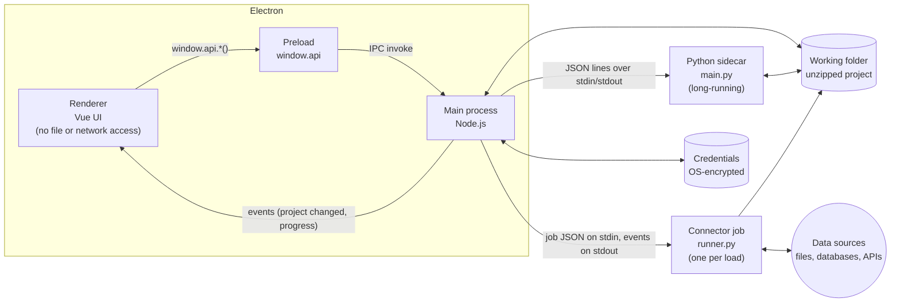
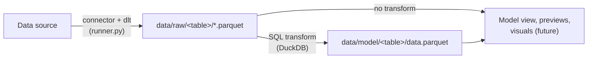

# Architecture

How PawpawBI is put together: the processes, how they talk, and how data flows from a source to
a report. For the reasons behind these choices see [decisions.md](decisions.md); for the
security side see [security.md](security.md).

## Processes

PawpawBI runs as several cooperating processes:

| Process | Code | Responsibilities |
|---|---|---|
| **Renderer** | `src/App.vue`, `src/views/`, `src/components/` | The whole UI. Sandboxed like a web page: no Node.js, no file system. Everything else goes through `window.api`. |
| **Preload** | `src/preload.ts` | Defines `window.api`: a short list of named functions, each forwarding to one IPC channel. Types in `src/shared/types.ts`. |
| **Main** | `src/main.ts` and the modules below | Owns the window, the open project, files on disk, credentials and the Python processes. |
| **Python sidecar** | `python/sidecar/main.py` | Started on first use, lives until the app quits. Handles quick requests: the connector catalog, table schemas and previews, SQL transforms. |
| **Connector job** | `python/sidecar/runner.py` | A fresh process for each "connect" or "load". Can be slow, can use a connector's own Python environment, and can crash without affecting the app. |

### Main-process modules

| Module | Does |
|---|---|
| `main.ts` | Creates the window, registers IPC handlers, asks to save on close, opens external links in the browser. |
| `projects.ts` | Creating, opening, saving and closing projects; working folders and crash recovery; the recent list; chat history and the current workflow step. |
| `pawpaw-archive.ts` | Reading and writing `.pawpaw` ZIP files, including the safety checks on paths. No Electron imports, so it's testable with plain Node. |
| `data.ts` | Data sources (`sources/*.json`), connector environments, running connector jobs, table schemas and previews, the model diagram, SQL transforms, deleting tables. |
| `credentials.ts` | Encrypting and storing secrets with Electron's `safeStorage`. |
| `python.ts` | Paths to the bundled Python, the shared flags and environment for Python processes, and the sidecar client (`callPython`). |

## Talking between processes

**Renderer → main.** Every call is `window.api.<area>.<method>()` → `ipcRenderer.invoke('<area>:<method>')`
→ an `ipcMain.handle` in the main process. Areas: `projects`, `data`, `python`. Values must be
plain data (wrap Vue state in `plain()`). Errors arrive as rejected promises; show them with
`errorMessage()`.

**Main → renderer.** Two event streams: `project:changed` (name, path, unsaved-changes flag) and
`data:progress` (status messages while connecting or loading).

**Main → sidecar.** One JSON object per line on the sidecar's stdin:
`{"id": 1, "method": "describe_tables", "params": {...}}`, answered by one line on its stdout:
`{"id": 1, "result": ...}` or `{"id": 1, "error": "..."}`. The method table is `METHODS` in
`python/sidecar/main.py`. stdout is reserved for these replies; logging goes to stderr, which the
main process prints to its console.

**Main → connector job.** `runner.py` reads one job as JSON on stdin (including decrypted secrets,
which therefore never appear on a command line) and writes events, one per line:
`{"event": "progress", "message": ...}`, then `{"event": "result", ...}` or
`{"event": "error", "message": ..., "detail": <traceback>}`.

## Projects on disk

A `.pawpaw` file is a ZIP (format: [pawpaw-file-format.md](pawpaw-file-format.md)). The app never
edits it in place:

1. **Open:** validate the archive, then extract it to a working folder,
   `%APPDATA%\PawpawBI\workspaces\<project id>-<path hash>\project\`. A `state.json` beside it
   records which file it came from and whether there are unsaved changes.
2. **Work:** everything (data loads, transforms, chat, layout) reads and writes that folder, and
   marks the project as changed.
3. **Save:** zip the folder to a temporary file next to the original, then replace the original
   in one step.
4. **Close:** delete the working folder. If the app crashes instead, the folder survives and the
   next open offers to recover it.

Data kept outside the project file, on this computer only:

| Where (under `%APPDATA%\PawpawBI\`) | What |
|---|---|
| `credentials\<project>\<source>.bin` | Encrypted secrets for each data source |
| `connector-envs\<connector>\` | Python environments for connectors that need extra packages |
| `dlt\<project>\` | dlt's local pipeline state |
| `recent-projects.json` | The start screen's recent list |
| `workspaces\` | Working folders of open (or crashed) projects |

## Data flow

1. **Connect.** The user picks a connector in the Add data screen. Its form comes from the
   catalog (`python/sidecar/connectors/`). Saving writes non-secret settings to
   `sources/<id>.json` and secrets to the credential store.
2. **Discover.** A connector job builds the dlt source (`Connector.build(settings)`) and lists its
   resources, i.e. the tables it can load. For databases this is also the connection test.
3. **Load.** A connector job runs a dlt pipeline into the project's `data/` folder using dlt's
   `filesystem` destination, writing Parquet into `data/raw/<table>/`. Every load is a full refresh.
   Nested data becomes child tables named `parent__child`.
4. **Transform** (optional). A table's SQL query runs in DuckDB over the raw Parquet files; the
   result is written to `data/model/<table>/` and used in place of the raw table everywhere. After
   each load, the affected transforms are re-run.
5. **Use.** The Model view and previews read schemas and rows through the sidecar. Visuals and
   relationships will read the same way.

## The query engine

All reading of loaded data goes through `python/sidecar/engine.py`. For each request it opens a
fresh in-memory DuckDB, creates one view per table over that table's Parquet files, and locks
the connection down (see [security.md](security.md)). Nothing is stored in DuckDB.

There are two views of the data:
- **`current`** (previews and table info): a transformed table's result if it has one,
  otherwise its original data.
- **`raw`** (SQL transforms): always the original data, so transforms never build on each other.

dlt's `_dlt_*` bookkeeping columns are left out of the views. Values are converted to JSON-safe
ones (`engine.json_value`) before going to the UI.

## Connector environments

Connectors that need extra Python packages declare them in their catalog entry (`packages`). The
first time one is used, `data.ts` creates `connector-envs\<connector id>\` with
`python -m venv --system-site-packages` layered on the bundled Python. It shares dlt, DuckDB and
the rest, and adds only the connector's packages, installed with `python/constraints.txt` as
constraints so shared packages never change version. A stamp file records the Python path,
packages and constraints, and the environment is rebuilt whenever any of them change (e.g. after
an app update moves the Python install). That connector's jobs then run with that environment's
Python.

## The UI

`App.vue` shows the start screen (`views/SplashScreen.vue`) or an open project
(`views/ProjectWorkspace.vue`). In a project:

- **Top bar:** back to projects, the project name, the workflow steps (`WorkflowSteps.vue`), and Save.
- **Left:** the assistant chat (`ChatPanel.vue`). Its replies are placeholders in `src/workflow.ts`
  until an AI model is connected.
- **Main area:** follows the workflow step. **Add data** is `components/data/GetData.vue` (the
  connector gallery, source setup and table previews). **Model data** is `ModelData.vue`, the
  draggable table canvas, which opens `TransformEditor.vue` for SQL. **Build visuals** is
  `ReportCanvas.vue`, an empty placeholder.

The current workflow step is saved with the project (`chat/session.json`).

## Build and packaging

Electron Forge with Vite (`forge.config.mts`) builds three bundles, for the main process, preload
and renderer, into `.vite/`. Packaging copies the `python/` folder (runtime, sidecar, lock file) and
the window icon in as extra resources, so in the packaged app Python lives at
`resources\python\`. `src/python.ts` picks the right location for development or packaged runs.
The `prestart`, `prepackage` and `premake` scripts make sure the Python runtime exists first.
