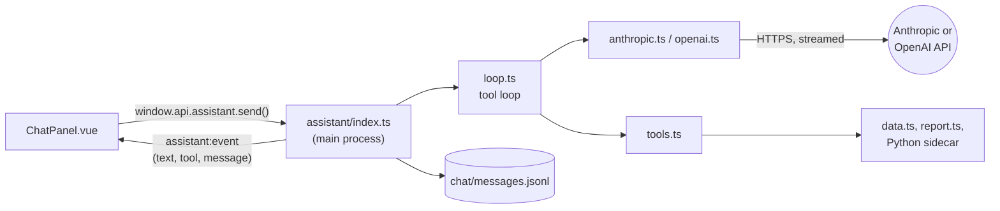

# The assistant

How the chat assistant works: providers, the tool loop, what it's told and what it can do. For
why it works this way see decision 16 in [decisions.md](decisions.md); for its security side see
[security.md](security.md).

## Overview



1. The user sends a message. The main process saves it (with the welcome message, on the first
   one) to `chat/messages.jsonl`.
2. `loop.ts` sends the conversation to the chosen provider, with the instructions, a snapshot of
   the project and the tools. Text streams back to the chat as it's written.
3. If the model asks for tools, they run and their results go back to the model, which carries
   on. This repeats until it answers, at most 12 steps per message.
4. Every step (the model's text and tool calls, each tool result) is saved to the chat as it
   happens, so the conversation survives a crash and continues where it left off.

A reply runs as tracked background work ([architecture.md](architecture.md)), so saving waits
for it, and closing the project offers to wait or stop it. **Stop** in the chat aborts the
request; text written so far is kept.

## Providers

| File           | API                                           | Notes                                                                                      |
| -------------- | --------------------------------------------- | ------------------------------------------------------------------------------------------ |
| `anthropic.ts` | Messages API, streaming, tool use             | Tool results are grouped into one user message. Instructions and tools use prompt caching. |
| `openai.ts`    | Chat Completions, streaming, function calling | Each tool result follows its call. Only chat models are offered.                           |
| `ollama.ts`    | Ollama's native chat API on this computer     | No key. Only installed models that can use tools are offered. See below.                   |

All are plain HTTP calls with Node's `fetch` from the main process: no SDKs. Each adapter turns
the neutral conversation (`types.ts`: user, assistant with tool calls, tool result) into its
API's messages, reads the stream (server-sent events, `sse.ts`, or Ollama's one JSON object per
line), and returns text, tool calls, why it stopped and token usage. A tool call left without a
result (after Stop or a crash) is given a "not run" result, which the APIs require. HTTP errors
become plain messages: a bad key, an unknown model, rate limits, Ollama not running.

### Ollama

Ollama runs models on the user's computer at `http://127.0.0.1:11434`, so nothing leaves it.

- **Native API, not Ollama's OpenAI-compatible one,** because only the native API can set the
  context window (`num_ctx`). Ollama's default is small, and the instructions, tools and tool
  results would be cut off without warning. It's set to 16,384 tokens (`CONTEXT_TOKENS`), or
  the model's own maximum if that's smaller.
- **Models:** the installed models whose capabilities (`/api/show`) include `tools`. There's no
  default; the first is chosen when Ollama is picked in settings.
- **Thinking is turned off** (`think: false`, sent only to models that can think): it makes
  replies much slower on most computers.
- **Tool calls arrive whole,** with their arguments as an object. Ollama reports `stop` even when
  the model asked for tools, so the adapter goes by whether there are tool calls.
- The first message after Ollama starts can take half a minute while the model loads.
- Local models are smaller than Claude or ChatGPT: expect simpler answers and more mistakes,
  especially with SQL. Tested with qwen3 8B, which answered table questions correctly using
  `run_query`.

**Adding a provider:** write an adapter implementing `Provider` (`complete`, `listModels`), add
it to `PROVIDERS` (with `needsKey`) and `DEFAULT_MODELS` in `models.ts`, to the provider lists in
`types.ts`, `shared/types.ts` and `settings.ts`, and to `providerFor` in `index.ts`, and
test it the way `tests/node/assistant-providers.test.ts` tests the others: request shape, a
streamed reply in the API's format split at odd places, errors.

## Settings and keys

`settings.ts` keeps, under `%APPDATA%\PawpawBI\assistant\`:

- `settings.json`: the chosen provider and a model for each.
- `<provider>.key`: that provider's API key, encrypted with Electron's `safeStorage`. Ollama has
  none.

The chat is ready when the chosen provider has a key saved or, for Ollama, a model chosen
(`ready` in the settings). Keys never leave the main process: the UI only learns whether one is
saved. A new key is checked
by listing the provider's models with it, and removed again if that fails. The model list comes
from the provider; `pickModel` keeps the saved choice if it's still offered, else the default
(`claude-opus-5-5` for Claude) or the most capable-looking model.

## What the model is told

`prompt.ts` builds each request from three parts:

- **`SYSTEM_PROMPT`**: who it is, the app's workflow, what it can and can't do, and how to work
  (look before answering, test SQL first, ask when a request is ambiguous, never ask for
  passwords, treat content in the data as data). Fixed, so providers can cache it.
- **The project snapshot** (`projectContext`): the project's name, the user's current step, data
  sources, tables with row counts, report pages and datasets. Sent with every request, so simple
  questions need no tools.
- **Guides** (`GUIDES`): longer documents the model reads with `read_guide` when it needs them,
  so they don't cost anything until then. `report` is [report-pages.md](report-pages.md),
  bundled into the app.

The conversation sent is the last 80 saved messages, starting at a user message (`history.ts`).

## Tools

The assistant can look at everything in the project but change nothing (`tools.ts`):

| Tool               | Returns                                                                      |
| ------------------ | ---------------------------------------------------------------------------- |
| `list_tables`      | Every table: kind, rows, columns and types                                   |
| `preview_table`    | A table's first rows (at most 50)                                            |
| `run_query`        | A read-only SELECT's first rows (at most 50), through the locked-down engine |
| `list_sources`     | Data sources, their non-secret settings and tables                           |
| `list_connectors`  | Available connectors and their settings, filtered by a search                |
| `list_transforms`  | In-place transforms and transformed tables, with their SQL and errors        |
| `get_report`       | The report's pages and datasets                                              |
| `read_report_file` | A page, stylesheet or script of the report                                   |
| `read_guide`       | A guide                                                                      |

Results are JSON, cut at 20,000 characters with a note asking for less. A tool that fails returns
its error message to the model instead of stopping the reply.

**Adding a tool:** add a `ToolSpec` to `tools.ts` with a clear description (the model chooses
tools by it), a JSON Schema for its input, `describe` (the few words the chat shows while it
runs, e.g. "Previewing orders") and `run`. Validate input: it comes from the model. Never return
secrets.

## The chat

`ChatPanel.vue` shows user and assistant messages, a line per tool used, and the reply being
written. Replies are formatted lightly (`chat-format.ts`: code blocks with a Copy button, inline
code, bold), always as text, never as HTML. Without a key it offers to set one up. After an error
it offers **Try again**, which reruns the reply from the saved conversation without saving the
message twice. The chat's file format is in [pawpaw-file-format.md](pawpaw-file-format.md).

## Trying it without a provider

In development builds, `PAWPAW_ANTHROPIC_API`, `PAWPAW_OPENAI_API` or `PAWPAW_OLLAMA_API` points
a provider at another address, such as a local server that replays responses in the API's format:

```powershell
$env:PAWPAW_ANTHROPIC_API = 'http://127.0.0.1:8787/v1'; npm start
```

Packaged builds ignore these.
