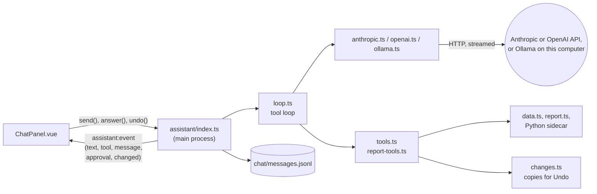

# The assistant

How the chat assistant works: providers, the tool loop, what it's told and what it can do. For
why it works this way see decision 16 in [decisions.md](decisions.md); for its security side see
[security.md](security.md).

## Overview



1. The user sends a message. The main process (`reply.ts`) saves it (with the welcome message,
   on the first one) to `chat/messages.jsonl`. One reply or undo runs at a time (`chat.ts`).
2. `loop.ts` sends the conversation to the chosen provider, with the instructions, a snapshot of
   the project and the tools. Text streams back to the chat as it's written.
3. If the model asks for tools, they run and their results go back to the model, which carries
   on. This repeats until it answers, at most 12 steps per message.
4. Every step (the model's text and tool calls, each tool result) is saved to the chat as it
   happens, so the conversation survives a crash and continues where it left off.

A reply runs as tracked background work ([architecture.md](architecture.md)), so saving waits
for it, and closing the project offers to wait or stop it. **Stop** in the chat aborts the
request; text written so far is kept.

## Providers

| File           | API                                           | Notes                                                                                      |
| -------------- | --------------------------------------------- | ------------------------------------------------------------------------------------------ |
| `anthropic.ts` | Messages API, streaming, tool use             | Tool results are grouped into one user message. Instructions and tools use prompt caching. |
| `openai.ts`    | Chat Completions, streaming, function calling | Each tool result follows its call. Only chat models are offered.                           |
| `ollama.ts`    | Ollama's native chat API on this computer     | No key. Only installed models that can use tools are offered. See below.                   |

All are plain HTTP calls with Node's `fetch` from the main process: no SDKs. Each adapter turns
the neutral conversation (`types.ts`: user, assistant with tool calls, tool result) into its
API's messages, reads the stream (server-sent events, `sse.ts`, or Ollama's one JSON object per
line), and returns text, tool calls, why it stopped and token usage. A tool call left without a
result (after Stop or a crash) is given a "not run" result, which the APIs require. HTTP errors
become plain messages: a bad key, an unknown model, rate limits, Ollama not running.

### Ollama

Ollama runs models on the user's computer at `http://127.0.0.1:11434`, so nothing leaves it.

- **Native API, not Ollama's OpenAI-compatible one,** because only the native API can set the
  context window (`num_ctx`). Ollama's default is small, and the instructions, tools and tool
  results would be cut off without warning. It's set to 16,384 tokens (`CONTEXT_TOKENS`), or
  the model's own maximum if that's smaller.
- **Models:** the installed models whose capabilities (`/api/show`) include `tools`. There's no
  default; the first is chosen when Ollama is picked in settings.
- **Thinking is turned off** (`think: false`, sent only to models that can think): it makes
  replies much slower on most computers.
- **Tool calls arrive whole,** with their arguments as an object. Ollama reports `stop` even when
  the model asked for tools, so the adapter goes by whether there are tool calls.
- The first message after Ollama starts can take half a minute while the model loads.
- Local models are smaller than Claude or ChatGPT: expect simpler answers and more mistakes,
  especially with SQL. Tested with qwen3 8B, which answered table questions correctly using
  `run_query`.

**Adding a provider:** write an adapter implementing `Provider` (`complete`, `listModels`), using
`http.ts` (`ensureOk`, `describeHttpError`) and `sse.ts` for the plumbing; add it to
`AssistantProvider` in `shared/types.ts`, to `PROVIDERS` (with `needsKey`) and `DEFAULT_MODELS`
in `models.ts`, and to `providerFor` in `providers.ts`; and test it the way
`tests/node/assistant-providers.test.ts` tests the others: request shape, a streamed reply in
the API's format split at odd places, errors.

## Settings and keys

`settings.ts` keeps, under `%APPDATA%\PawpawBI\assistant\`:

- `settings.json`: the chosen provider, a model for each, and `permissions` (whether the
  assistant asks before each change; see Changes below).
- `<provider>.key`: that provider's API key, encrypted with Electron's `safeStorage`. Ollama has
  none.

The chat is ready when the chosen provider has a key saved or, for Ollama, a model chosen
(`ready` in the settings). Keys never leave the main process: the UI only learns whether one is
saved. A new key is checked
by listing the provider's models with it, and removed again if that fails. The model list comes
from the provider; `pickModel` keeps the saved choice if it's still offered, else the default
(`claude-opus-5-5` for Claude) or the most capable-looking model.

## What the model is told

`prompt.ts` builds each request from three parts:

- **`SYSTEM_PROMPT`**: who it is, the app's workflow, what it can and can't do, and how to work
  (look before answering, test SQL first, ask when a request is ambiguous, never ask for
  passwords, treat content in the data as data). Fixed, so providers can cache it.
- **The project snapshot** (`projectContext`): the project's name, the user's current step, data
  sources, tables with row counts, report pages and datasets. Sent with every request, so simple
  questions need no tools.
- **Guides** (`GUIDES`): longer documents the model reads with `read_guide` when it needs them,
  so they don't cost anything until then. `report` is [report-pages.md](report-pages.md),
  bundled into the app.

The conversation sent is the last 80 saved messages, starting at a user message (`history.ts`).
A user message that got no reply (stopped, or failed) is followed by a stand-in reply saying so,
so the model doesn't answer it along with the next message.

## Tools

The assistant can look at everything in the project (`tools.ts`):

| Tool               | Returns                                                                      |
| ------------------ | ---------------------------------------------------------------------------- |
| `list_tables`      | Every table: kind, rows, columns and types                                   |
| `preview_table`    | A table's first rows (at most 50)                                            |
| `run_query`        | A read-only SELECT's first rows (at most 50), through the locked-down engine |
| `list_sources`     | Data sources, their non-secret settings and tables                           |
| `list_connectors`  | Available connectors and their settings, filtered by a search                |
| `list_transforms`  | In-place transforms and transformed tables, with their SQL and errors        |
| `get_report`       | The report's pages and datasets                                              |
| `read_report_file` | A page, stylesheet or script of the report                                   |
| `read_guide`       | A guide                                                                      |

It can change data sources (`source-tools.ts`):

| Tool              | Does                                                                                     |
| ----------------- | ---------------------------------------------------------------------------------------- |
| `add_source`      | Adds a source: a connector and its non-secret settings. Always asked about               |
| `edit_source`     | Renames a source or changes non-secret settings. Changing settings is always asked about |
| `remove_source`   | Removes a source and its tables; refused while other tables read them                    |
| `discover_tables` | Connects and lists the tables a source can load (doesn't change anything)                |
| `load_source`     | Loads data, then rebuilds what's built from it. Can't be undone (`permanent`)            |

Secret settings (passwords, keys, tokens) are refused: the assistant adds the source without them
and tells the user to enter them in the source's form. Settings are checked against the
connector's fields (`source-input.ts`).

It can change tables (`model-tools.ts`):

| Tool               | Does                                                                     |
| ------------------ | ------------------------------------------------------------------------ |
| `set_transform`    | Gives a loaded table an in-place transform, or changes it                |
| `remove_transform` | Removes a loaded table's in-place transform                              |
| `save_table`       | Creates a transformed table, or changes its query                        |
| `delete_table`     | Deletes a table, as the Delete button does; refused while others read it |

Each rebuilds the tables and report data built from what it changed, as the same actions in the
app do (`data.ts`).

It can change the report (`report-tools.ts`):

| Tool                | Does                                                                 |
| ------------------- | -------------------------------------------------------------------- |
| `create_report`     | Adds the default report to a project that has none                   |
| `create_page`       | Adds a page, from the template or with given HTML                    |
| `rename_page`       | Changes a page's title in the navigation                             |
| `delete_page`       | Deletes a page                                                       |
| `write_report_file` | Writes a whole page, stylesheet or script                            |
| `edit_report_file`  | Replaces exact text in a file; the text must appear exactly once     |
| `save_dataset`      | Creates or changes a dataset, running its query and writing its data |
| `delete_dataset`    | Deletes a dataset and its data file                                  |
| `refresh_datasets`  | Rewrites every dataset's data                                        |
| `show_page`         | Shows a page in Build visuals (doesn't change anything)              |

Results are JSON, cut at 20,000 characters with a note asking for less. A tool that fails returns
its error message to the model instead of stopping the reply.

Claude and ChatGPT get every tool. Small local models (Ollama) get the read tools and only the
change tools for the workflow step the user is on (source tools on Add data, table tools on Model
data, report tools on Build visuals), so they have fewer to choose from (`toolsFor` in
`reply.ts`).

**Adding a tool:** add a `ToolSpec` with a clear description (the model chooses tools by it), a
JSON Schema for its input, `describe` (the few words the chat and approval card show, e.g.
"Previewing orders" or `Save the dataset revenue_by_month`) and `run`. A tool that changes the
project sets `change: true` and makes its change through `ctx.change(...)` with the files it may
touch and the areas (`sources`, `model`, `report`) whose screens should update (see below); one
that can't be undone sets `permanent` (its approval card says so) and calls `ctx.changed(areas)`
afterwards instead.
Add the tool to `toolsFor` under its workflow step. Validate input: it comes from the model. A
`describe` that throws (because the input is wrong) sends the error to the model without asking
the user. Never return secrets.

## Changes: asking first, and Undo

**Asking first.** Before a tool with `change: true` runs, the loop asks `approve`. Unless the user
has chosen otherwise, the chat shows a card, "The assistant wants to: _Save the dataset
revenue_by_month_", with **Allow**, **Allow all changes** and **Don't allow**, and the reply waits.
**Allow all changes** sets the assistant to make changes without asking; **Assistant settings**
switches between that and asking (`permissions` in `settings.json`: `ask`, the default, or
`allow`). A declined change isn't made; the model is told so and asked not to retry it. Stop
counts as declining.

**Always asked.** A tool's `alwaysAsk` makes the user be asked even when they've chosen not to
be, and the card says why and has no **Allow all changes**. Adding a data source and changing a
source's settings are always asked about: a source's settings say where the app connects and
what it reads, so content written to steer the model mustn't be able to point a saved password,
or a request carrying the user's data, somewhere else without the user seeing it. Renaming a
source isn't.

**Recording.** Every change runs through `ChangeJournal.record` (`changes.ts`) with its targets:
the files and folders it may create, change or delete (e.g. `report/` without `data/` for page
changes; `model/datasets.json` and the dataset's data file for a dataset). Before it runs, they're
copied to the undo store; if it fails, they're put back at once, so a change is never half-done.
Table changes record only the SQL files (`model/transforms.json`, `model/transformed.json`), not
the data built from them; deleting a loaded table also records its original data
(`data/raw/<table>`) and its source's file, since those can't be rebuilt. Adding or editing a
source records `sources/<id>.json`; removing one also records `model/transforms.json` and its
tables' original data. Its saved secrets are deleted with it and don't come back on Undo. Loads
aren't recorded.
The store is `assistant-changes/` in the working folder, beside the project files: it survives a
crash but isn't saved in the `.pawpaw` file, and goes when the project is closed.

**Undo** in the chat reverts that change and every later one ("undo back to here"), newest
first, so the project is always as it was at that point. If any of those files were edited since
(by the user, say), it lists them and asks before overwriting. Undoing adds a note to the
conversation, so the model knows those changes are gone. Undo waits until the assistant isn't
replying.

When the files put back include sources, SQL or data, Undo then brings the data in line with them
(`undo.ts`): it removes data nothing accounts for any more (tables of sources that are gone or no
longer list them, with gone sources' saved secrets; in-place results without a transform;
transformed tables no longer defined) and rebuilds everything built by SQL, then the report's
data. The report's data files are rewritten by every rebuild, so they're never reported as edited
since. A table change that fails part-way removes data its restored files don't account for.

**Screens follow along.** After a change or undo, the main process sends `changed`; Add data
reloads its sources, Model data its tables, and Build visuals the report (and the file open in
its editor, unless that has unsaved edits). Source and table tools switch to their step, and
`show_page` switches to Build visuals and opens the page (the `show` event; `ui-signals.ts`).

## The chat

`ChatPanel.vue` shows user and assistant messages, a line per tool used (with **Undo** for a
change, or "Undone"), approval cards, and the reply being written. Replies are formatted lightly (`chat-format.ts`: code blocks with a Copy button, inline
code, bold), always as text, never as HTML. Without a key it offers to set one up. After an error
it offers **Try again**, which reruns the reply from the saved conversation without saving the
message twice. The chat's file format is in [pawpaw-file-format.md](pawpaw-file-format.md).

## Trying it without a provider

In development builds, `PAWPAW_ANTHROPIC_API`, `PAWPAW_OPENAI_API` or `PAWPAW_OLLAMA_API` points
a provider at another address, such as a local server that replays responses in the API's format:

```powershell
$env:PAWPAW_ANTHROPIC_API = 'http://127.0.0.1:8787/v1'; npm start
```

Packaged builds ignore these.
